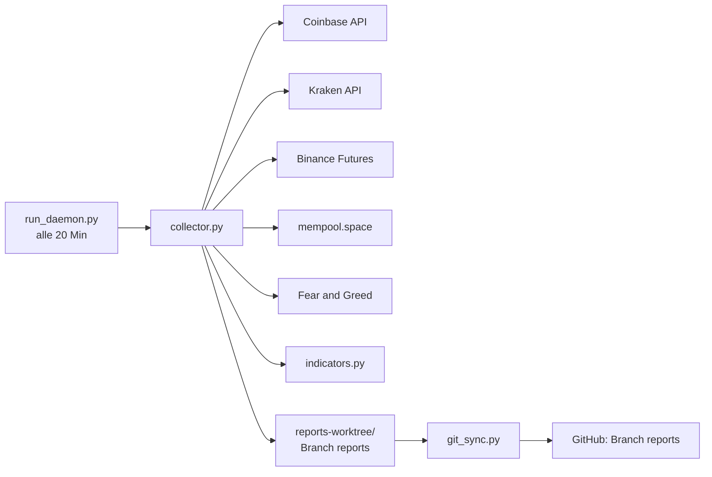

# 📡 BTC-reports-termux

> Automatisierte BTC/EUR-Marktberichte für Android (Termux): Spotpreise, Orderbuch, Binance-Futures, On-Chain-Daten, Fear & Greed sowie technische Indikatoren (RSI, EMA, Bollinger). Alle 20 Minuten entsteht ein neuer, zeitgestempelter Bericht. Die Berichte landen im Branch `reports`, der Code bleibt auf `main`.

---

## 🌿 Branch-Konzept

| Branch | Inhalt | Änderung |
| :--- | :--- | :--- |
| `main` | Quellcode, Konfiguration, README, Tests | manuell, bewusst versioniert |
| `reports` | Marktberichte `reports/report_JJJJMMTT_HHMMSS.md` | automatisch, ein Commit pro Bericht |

Berichte werden **nie überschrieben**. Jeder Lauf erzeugt eine neue Datei. Gleichzeitige Läufe in derselben Sekunde erhalten ein Suffix (`_1`, `_2`, …).

---

## 🏗️ Architektur



---

## 📁 Projektstruktur

| Datei | Funktion |
| :--- | :--- |
| `run_daemon.py` | Startet `collector.py` im 20-Minuten-Takt, mit Zeitlimit und Logging |
| `collector.py` | Datenabruf, Report-Erstellung, Veröffentlichung |
| `indicators.py` | Berechnungen (RSI, EMA, Bollinger, Orderbuch, Funding), ohne Netzwerkzugriff |
| `git_sync.py` | Verwaltet den Worktree für `reports`, committet und veröffentlicht Berichte |
| `config.py` | Zentrale Einstellungen: Paare, Zeitrahmen, Intervalle, Schwellen, Pfade |
| `test_indicators.py` | Unit-Tests (ohne Netzwerkzugriff) |
| `reports-worktree/` | Lokaler Worktree des Branches `reports` (nicht im Repo versioniert) |

---

## 📊 Aufbau eines Berichts

1. **⚠️ Datenlücken** (nur bei Fehlern): Quellen, die nicht verfügbar waren
2. **📊 Marktübersicht**: Spot, Volumen, Spread, Orderbuch-Tiefe und Druck, Bollinger-Bänder, Status je Börse
3. **⚡ Derivate, Sentiment & On-Chain**: Fear & Greed, Open Interest, Funding Rate, Mempool, Gebühren
4. **📈 Indikatoren**: RSI, EMA 9/21 und Trend je Zeitrahmen (Coinbase 15m/1h/6h, Kraken 15m/1h/4h)

Fehlende Werte erscheinen als `n/a ⚠️`. Es gibt keine Ersatzwerte. Schlägt der Abruf beider Börsen fehl, wird kein Bericht erzeugt.

---

## 🧠 Indikatorlogik

| Indikator | Berechnung | Interpretation |
| :--- | :--- | :--- |
| **RSI (14)** | Wilder-Glättung | > 70 überkauft, < 30 überverkauft |
| **EMA 9 / 21** | Startwert SMA, Faktor 2/(n+1) | EMA 9 unter EMA 21 gilt als bärisch |
| **Bollinger-Bänder** | SMA(20) ± 2σ auf 1h-Schlusskursen | Einordnung der Volatilität |
| **Orderbuch-Druck** | Bids gegen Asks im ±1-%-Korridor | Asks > Bids → Verkäufer, sonst Käufer |
| **Funding Rate** | Binance `lastFundingRate` in % | > +0,01 % „Longs überhebelt“, < −0,01 % „Shorts überhebelt“ (Heuristik) |

Nur abgeschlossene Kerzen fließen in die Berechnung ein.

---

## 🚀 Installation (Termux)

**1. Pakete installieren** (Git ab Version 2.42 nötig für den Branch-Anlauf)

```bash
pkg update && pkg install python git
git --version
```

Voraussetzung ist außerdem das Python-Paket `requests`.

**2. Git-Identität setzen**

```bash
git config --global user.name "Dein Name"
git config --global user.email "du@example.com"
```

**3. Repository holen**

Die Repo-URL lautet `https://github.com/N0sferatu1337/BTC-reports-termux`. Klone sie in deinen Projektordner `~/crypto-bot` und wechsle dorthin.

Der Branch `reports` wird beim ersten Lauf automatisch angelegt. Dafür braucht das Repo einen Remote `origin` mit Schreibrechten.

**4. Tests ausführen**

```bash
python3 -m unittest test_indicators -v
```

**5. Starten**

```bash
python3 collector.py     # einmaliger Lauf
python3 run_daemon.py    # Dauerbetrieb, alle 20 Minuten
```

Die Berichte findest du auf GitHub im Branch `reports` unter `reports/`.

---

## 🔌 Datenquellen

- [Coinbase Exchange API](https://docs.cdp.coinbase.com/exchange/docs/welcome): Kerzen und Orderbuch
- [Coinbase Spot API](https://api.coinbase.com/v2/prices/BTC-EUR/spot): Spotpreis
- [Kraken Public API](https://docs.kraken.com/api/): Ticker, Depth, OHLC
- [Binance Futures API](https://fapi.binance.com): Open Interest, Funding Rate
- [mempool.space API](https://mempool.space/docs/api): Gebühren und Mempool
- [alternative.me Fear & Greed](https://alternative.me/crypto/fear-and-greed-index/): Sentiment-Index

---

## ⚠️ Grenzen

- **Coinbase-Orderbuch:** Level 2 liefert nur die besten ca. 50 Preisstufen. Der ±1-%-Korridor ist daher nicht immer vollständig.
- **Externe Abhängigkeit:** Ist eine API nicht erreichbar, fehlt der Wert im Bericht und wird unter „Datenlücken“ ausgewiesen.
- **Heuristiken:** Funding- und Orderbuch-Interpretation sind Richtwerte, keine Handelssignale.

---

## ⚖️ Haftungsausschluss

Dieses Projekt dient ausschließlich Informations- und Lernzwecken und ist **keine Anlageberatung**.

---

## 📜 Lizenz

Noch nicht festgelegt. Im Repository wurde keine `LICENSE`-Datei gefunden.
