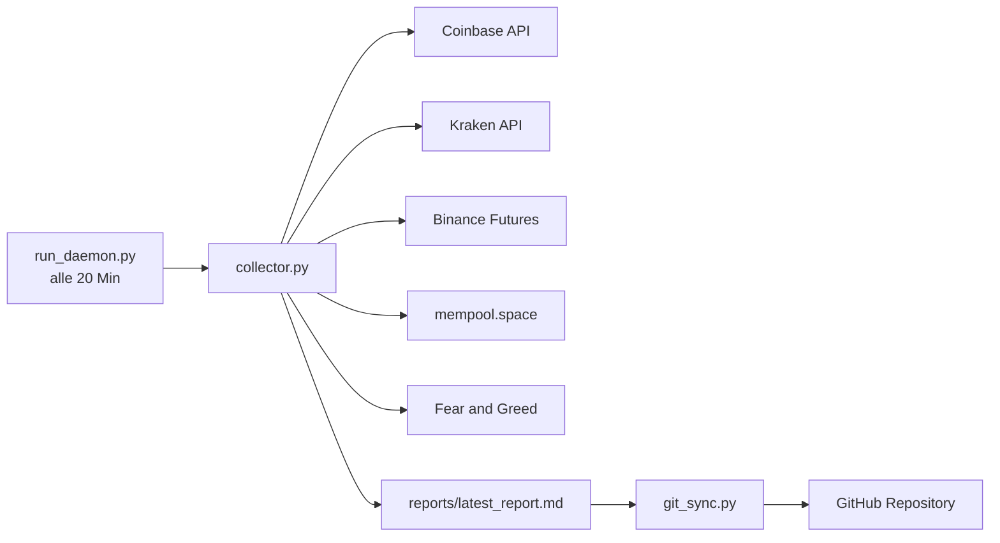

# 📡 BTC-reports-termux

> Automatisierte BTC/EUR-Marktberichte für Android (Termux): Spotpreise, Orderbuch, Binance-Futures, On-Chain-Daten, Fear & Greed sowie technische Indikatoren (RSI, EMA, Bollinger). Alle 20 Minuten als Markdown erzeugt und automatisch nach GitHub gepusht.

---

## ✨ Features

| Bereich | Datenquelle | Was wird erfasst |
| :--- | :--- | :--- |
| 💶 **Spotpreise** | Coinbase, Kraken | Aktueller BTC/EUR-Kurs und 24h-Volumen |
| 📚 **Orderbuch** | Coinbase (Level 2) | Summe der Top-10-Bids und -Asks |
| ⚡ **Derivate** | Binance Futures (BTCUSDT) | Open Interest und Funding Rate |
| ⛓️ **On-Chain** | mempool.space | Empfohlene Gebühr, unbestätigte Transaktionen, Mempool-Größe |
| 😱 **Sentiment** | alternative.me | Fear & Greed Index |
| 📈 **Indikatoren** | Aus Kerzendaten berechnet | RSI (14), EMA 9/21, Bollinger-Bänder (20, 2σ) |
| 🔁 **Automatisierung** | Daemon + Git | Report alle 20 Minuten, automatischer Commit und Push |

---

## 🏗️ Architektur

Der Ablauf besteht aus drei Schichten: einem Daemon, dem Collector und dem Git-Sync.



---

## 📁 Projektstruktur

| Datei / Ordner | Funktion |
| :--- | :--- |
| `run_daemon.py` | Endlosschleife, die `collector.py` alle 20 Minuten startet |
| `collector.py` | Hauptskript: Datenabruf, Indikatorberechnung, Report-Erstellung, Git-Sync |
| `git_sync.py` | Staging, Commit, `pull --rebase` und Push nach `origin/main` |
| `indicators.py` | Hilfsfunktionen für Orderbuch-Tiefe (±1 %) und Kraken Futures *(aktuell nicht von `collector.py` importiert)* |
| `config.py` | Paare und Intervalle als Konfiguration *(aktuell nicht von `collector.py` importiert)* |
| `reports/` | Erzeugte Marktberichte, u. a. `latest_report.md` |
| `data/` | Datenausgaben |
| `*.log` | Laufprotokolle des Daemons |

---

## 📊 Aufbau des Reports

Jeder Lauf überschreibt `reports/latest_report.md` mit folgenden Abschnitten:

1. **📊 Marktübersicht, Volumen & Orderbuch-Tiefe**: Preis, Volumen, Spread, Orderbuch-Druck und Bollinger-Bänder je Börse
2. **⚡ Derivate, Sentiment & On-Chain Metriken**: Fear & Greed, Open Interest, Funding Rate, Mempool-Daten, Gebühren
3. **📈 Multi-Timeframe-Indikatoren**: RSI, EMA 9/21 und Trendtendenz je Zeitrahmen
   - Coinbase: 15m, 1h, 6h
   - Kraken: 15m, 1h, 4h

---

## 🧠 Indikatorlogik

| Indikator | Berechnung | Interpretation |
| :--- | :--- | :--- |
| **RSI (14)** | Wilder-Glättung der Gewinne und Verluste | > 70 überkauft, < 30 überverkauft, sonst neutral |
| **EMA 9 / 21** | Startwert SMA, Glättungsfaktor 2/(n+1) | EMA 9 unter EMA 21 gilt als bärisch, sonst als bullisch |
| **Bollinger-Bänder** | SMA(20) ± 2 σ auf 1h-Schlusskursen | Hilft bei der Einordnung der Volatilität |
| **Orderbuch-Druck** | Summe der Top-10-Bids gegen Top-10-Asks | Asks > Bids → Verkäuferdruck, sonst Käuferdruck |
| **Funding Rate** | Binance `lastFundingRate` in Prozent | Über 0,01 % wird „Longs überhebelt“ ausgewiesen (Heuristik) |

---

## 🚀 Installation (Termux)

**1. Pakete installieren**

```bash
pkg update && pkg install python git
pip install requests
```

**2. Repository klonen**

Das Git-Sync-Skript erwartet das Repository standardmäßig unter `~/crypto-bot` und einen Remote `origin` mit `main`-Branch sowie Schreibrechten.

```bash
git clone https://github.com/N0sferatu1337/BTC-reports-termux.git ~/crypto-bot
cd ~/crypto-bot
```

**3. Ausführen**

```bash
python3 collector.py    # einmaliger Lauf
python3 run_daemon.py   # Dauerbetrieb, alle 20 Minuten
```

> ℹ️ `run_daemon.py` ruft `collector.py` relativ auf. Starte den Daemon deshalb aus dem Repository-Verzeichnis.

---

## 🔌 Datenquellen

- [Coinbase Exchange API](https://docs.cdp.coinbase.com/exchange/docs/welcome): Kerzen und Orderbuch
- [Coinbase Spot API](https://api.coinbase.com/v2/prices/BTC-EUR/spot): Spotpreis
- [Kraken Public API](https://docs.kraken.com/api/): Ticker und OHLC-Kerzen
- [Kraken Futures API](https://futures.kraken.com/derivatives/api/v3/tickers): Derivate-Ticker *(in `indicators.py`)*
- [Binance Futures API](https://fapi.binance.com): Open Interest und Funding Rate
- [mempool.space API](https://mempool.space/docs/api): Gebühren und Mempool
- [alternative.me Fear & Greed](https://alternative.me/crypto/fear-and-greed-index/): Sentiment-Index

---

## ⚠️ Bekannte Einschränkungen

Diese Punkte sind im aktuellen Code belegt. Sie sollten vor einer Nutzung der Zahlen behoben werden.

- **Feste Werte statt Live-Daten:** Coinbase-Spread (11,69 €), Kraken-Spread (6,20 €) sowie Kraken-Bids (21,48) und -Asks (19,89) sind im Code fest hinterlegt. Das Coinbase-Volumen fällt bei fehlenden Kerzen auf 851,98 BTC zurück. Diese Werte erscheinen im Report wie echte Messwerte.
- **Kraken-Orderbuch-Druck:** Wegen der festen Werte zeigt der Report für Kraken immer „Käufer“.
- **Fallback-Werte bei Ausfällen:** Schlägt ein Abruf fehl, ersetzt das Skript die Daten durch Standardwerte (z. B. Fear & Greed = 50, Open Interest = 0). Der Report kennzeichnet diese Fälle nicht.
- **Unvollständige Kerzen:** Die letzte Kerze von Coinbase und Kraken ist oft noch nicht abgeschlossen und fließt in RSI und EMA ein.
- **Orderbuch-Definition:** `collector.py` summiert die Top-10-Level. Die ±1-%-Korridor-Logik liegt nur in `indicators.py`, das nicht eingebunden ist.
- **Redundanz:** Indikatorfunktionen existieren doppelt (`collector.py` und `indicators.py`). `config.py` wird nicht verwendet.
- **Git-Sync:** `git add .` committet alle Dateien im Verzeichnis. Ohne `.gitignore` landen Logs und `__pycache__` im Repository.
- **Pfadabhängigkeit:** `git_sync.py` nutzt den Pfad `~/crypto-bot`, unabhängig vom Ort des Collectors.
- **Keine Tests** im Repository.

---

## ⚖️ Haftungsausschluss

Dieses Projekt dient ausschließlich Informations- und Lernzwecken. Die Berichte stellen **keine Anlageberatung** dar. Indikatoren und Interpretationen sind vereinfachte Heuristiken.

---

## 📜 Lizenz

Noch nicht festgelegt. In der sichtbaren Repository-Übersicht wurde keine `LICENSE`-Datei gefunden.

---

<sub>Generiert aus den Quelldateien des Repositories. Stand der Analyse: Hauptzweig `main`.</sub>
